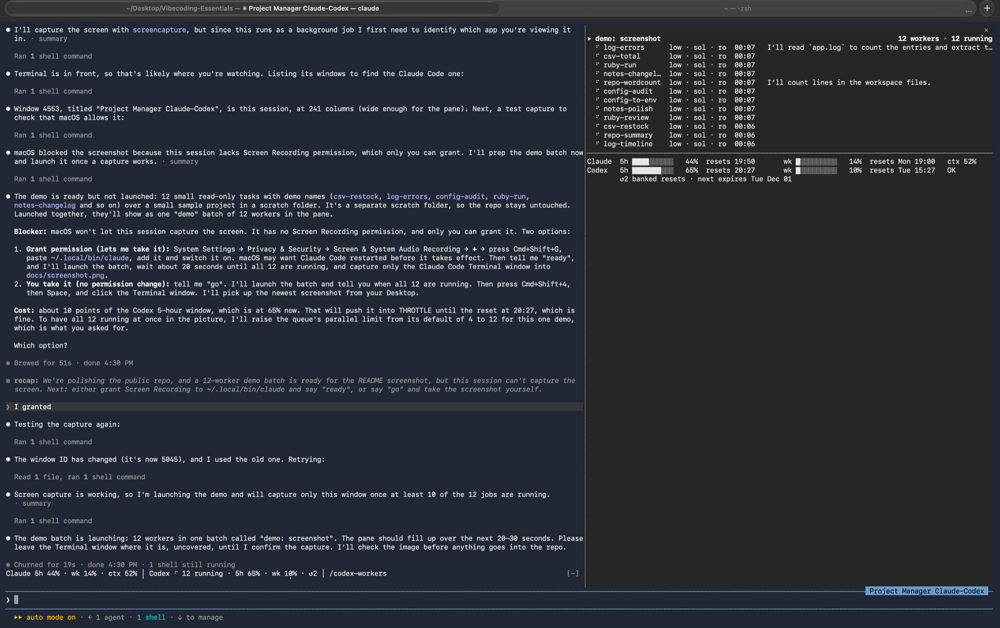

# claude-managed-codex-workers

[](https://github.com/HaochengBillYang/claude-managed-codex-workers/actions/workflows/ci.yml)

**Claude Code as the project manager, Codex as the workers.** Claude scopes the work, makes the design and taste calls, writes a brief per task, and reviews every result. Codex (GPT) workers do the execution: code to spec, tests, refactors and headless GUI tasks.

## Why this exists

Coding agents are good at executing a clear spec and weak at deciding what the spec should be. Running one agent for everything wastes the stronger model on routine work, and it burns through a single subscription's limits. This repo splits the two roles across two tools you may already pay for. Claude keeps the judgment: scope, architecture, review, and the final verdict. Codex gets the volume: implementation, tests, mechanical changes. Usage limits on both sides are read live, so the manager throttles, queues or pauses work before a limit is hit, and you can watch every worker in a live pane instead of guessing what's running.



*A real session: the PM conversation on the left; on the right, the codex-workers pane with a 12-worker demo batch running (each with its effort, model, sandbox and elapsed time), the Claude and Codex usage footer, and banked resets. The status row is at the bottom.*

What the plugin draws in Claude Code: the status row above the prompt, and the footer of the workers pane. This is text rendered by the plugin from its test fixtures, so the numbers are examples.

```text
Claude 5h 70% · wk 90% · ctx 91% │ Codex ⠋ 1 running · 5h 9% · wk 16% · ↺2 · ⧗3 │ /codex-workers

Claude  5h ███████░░░   70%  resets 19:33       wk █████████░   90%  resets Fri 19:23   ctx 91%
Codex   5h █░░░░░░░░░    9%  resets 23:10       wk ██░░░░░░░░   16%  resets Tue 14:49   THROTTLE
        ↺2 banked resets · next expires Tue Dec 01 · redeem before expiry
        ⧗3 queued tasks
```

## How it works

- **Delegation skill** (`skills/codex/`). Covers when to delegate, how to write a brief (task, constraints, acceptance criteria), effort and sandbox choice, and a review checklist that includes planting bugs to test the worker's tests.
- **Usage self-management.** It reads Codex's 5-hour and weekly limits and banked resets (from the Codex app-server), and Claude's own limits. A budget verdict (`OK` / `THROTTLE` / `BLOCKED`) gates every launch.
- **Budget-aware queue.** `codex-queue.sh drain` runs up to 4 workers in parallel when the budget allows, one at a time when it's tight, and none when blocked.
- **Live view** (`plugins/codex-workers/`). A Claude Code plugin with an always-on status row (Claude and Codex usage, banked resets, queued tasks), plus a workflow pane of running workers and their current command.
- **Landing rules.** Work happens in git worktrees. CI runs on Ubuntu and macOS, and installs are atomic, so the live setup never breaks mid-change.

## What's in the repo

| Path | What |
|---|---|
| `setup.md` | Full setup notes: roles, usage self-management, sandbox and GUI rules, machine quirks, workflow |
| `skills/codex/` | Claude Code skill: delegation rules, brief template, review checklist, and scripts `codex-run.sh`, `codex-usage.sh`, `codex-queue.sh`, `codex-resets-refresh.sh`, `claude-budget.sh`, `claude-fallback-budget.sh` |
| `plugins/codex-workers/` | Claude Code plugin (v0.2): an always-on status row above the prompt with Claude and Codex usage, and a live workflow pane of running Codex workers |
| `.claude-plugin/marketplace.json` | Makes this repo a plugin marketplace |
| `install.sh` | One-shot installer for a new machine |
| `tests/e2e.sh` | End-to-end check: install, usage budget, a live Codex worker, run records, optional Calculator GUI (`--gui`), plugin tests |
| `tests/review.sh`, `.github/workflows/ci.yml` | Local review checklist with optional live checks (`--live`, add `--gui` for Calculator), and CI for shell syntax, Ruby, and plugin checks on Ubuntu and macOS |
| `docs/codex-workers-design.md` | Design of the worker visualizer |
| `DESIGN.md`, `lib/`, `test/` | Smoke-test project (token-bucket rate limiter) built by two Codex workers |

## Install on a new machine (macOS)

Requirements: [Claude Code](https://claude.com/claude-code), plus the ChatGPT desktop app (which bundles the Codex CLI) or the standalone `codex` CLI, signed in.

```bash
git clone https://github.com/HaochengBillYang/claude-managed-codex-workers.git
cd claude-managed-codex-workers
./install.sh
```

`install.sh` does three things:
- copies the skill to `~/.claude/skills/codex`;
- adds two permission rules to `~/.claude/settings.json`, after backing it up;
- installs the `codex-workers` plugin at user scope, so it loads in every session.

It is safe to re-run. The manual steps it prints are covered in [setup.md](setup.md#new-machine).

To install only the plugin, use one of these:

At the prompt of a terminal Claude Code session:

```
/plugin install codex-workers --marketplace HaochengBillYang/claude-managed-codex-workers
```

From a shell:

```bash
claude plugin install codex-workers --marketplace HaochengBillYang/claude-managed-codex-workers
```

In the desktop app, click **+** next to the prompt box, then **Plugins**, then **Add marketplace** with `HaochengBillYang/claude-managed-codex-workers`, then **Add plugin**.

## Use

Just give Claude tasks. It checks Codex usage, writes a brief per worker, and launches each worker as a background shell. The **Codex workers** pane opens automatically. Type `/codex-workers` to toggle it.

The row above the prompt is always visible:

```
Claude 5h 23% · wk 41% · ctx 38% │ Codex idle · 5h 17% · wk 17% │ /codex-workers
```

It shows Claude's 5-hour and weekly limits and context fill, then Codex's worker status and limits. Numbers turn yellow at 70% and red at 90%.
